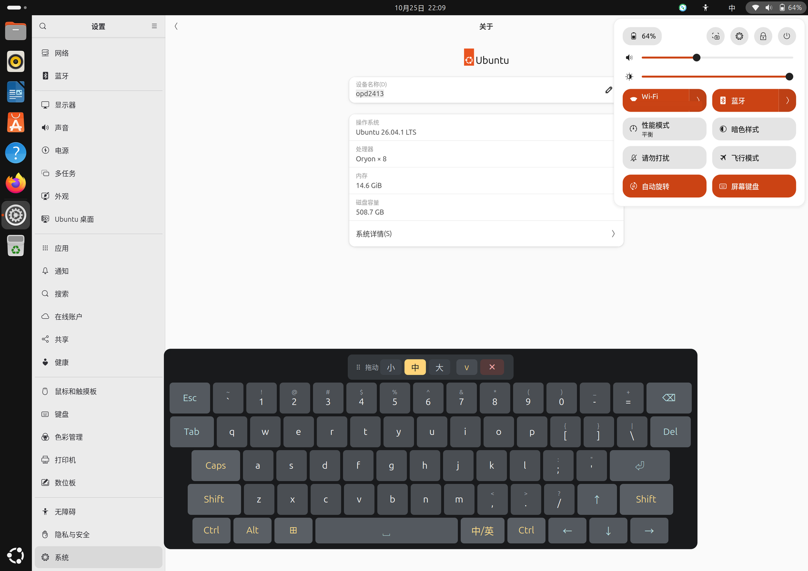
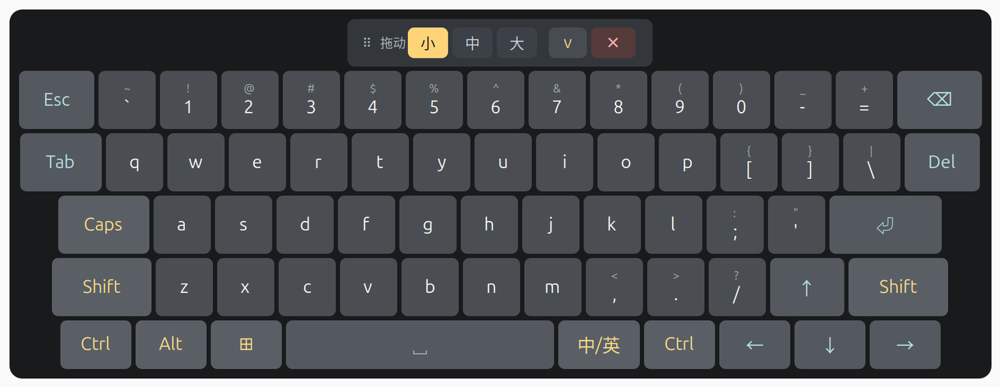
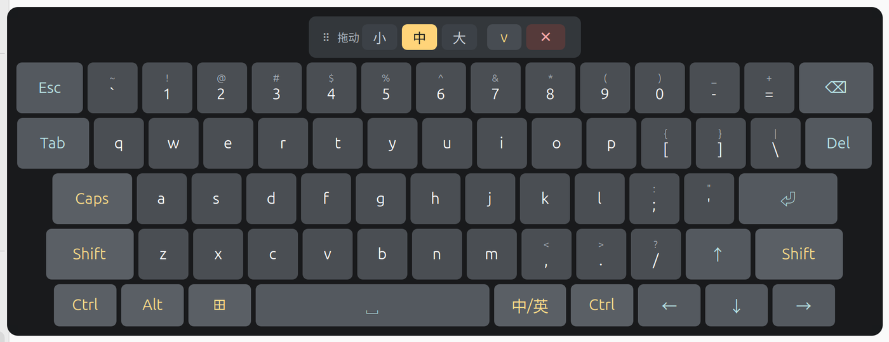
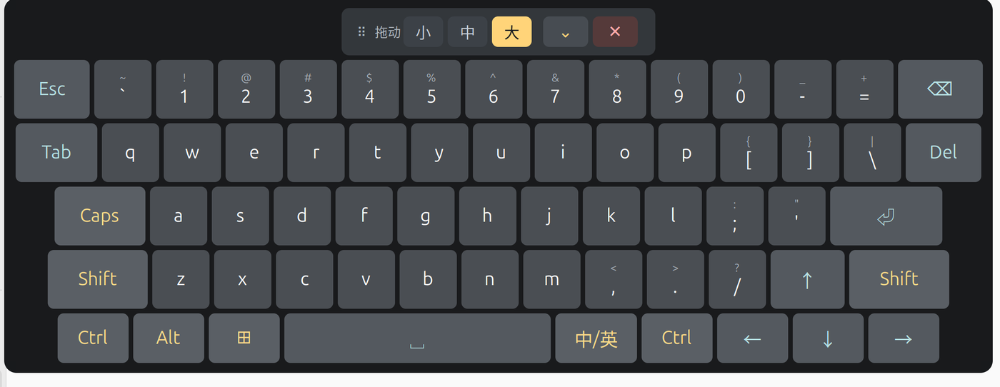

# PAD-OSK

一加 Pad 2 Pro（OPD2413 / `erhai`）在 **GNOME 50 Wayland** 下可用的屏幕键盘，其它平板请自测。
PC 风格布局、大按键、**支持中文输入**、可在系统菜单/应用抽屉里按需开关。

- 实测环境：一加 Pad 2 Pro，Ubuntu 26.04.1 LTS，GNOME Shell 50.1，arm64
- 实测应用：QQ（Electron）、Chrome、Firefox、终端 —— **均可正常输入，含中文**

> **中国大陆用户建议访问 [Gitee 镜像](https://gitee.com/HOSHINO6/ubuntu-pad-keyboard)**，
> 下载更快、连接更稳定；
> **海外用户建议使用 [GitHub](https://github.com/HOSHINO61/ubuntu-pad-keyboard)**。
> 两个仓库内容对等，均可使用。

---

## 适用环境

这个键盘是为arm64的 Ubuntu 移植方案配套做的，**不是通用屏幕键盘**：

| 项目 | 要求 |
|---|---|
| 设备 | 一加平板 2 Pro（OPD2413 / `erhai` / SM8750P，其它平板自测） |
| 系统 | 已按 [Ubuntu for OnePlus Pad 2 Pro](https://github.com/yzddmr6/onepluspad-2pro-mainline/blob/main/README.zh-CN.md) 完成安装，其它平板请按型号安装 | 
| 桌面 | **GNOME 50、Wayland 会话** |

上游项目一般提供了分区、系统安装和硬件适配的完整流程；本仓库只负责其中的
**触屏输入**这一块。装系统、分区、驱动问题请到上游仓库反馈，不要提到这里。

> X11 会话、KDE、其他合成器上不能用——本扩展依赖 GNOME Shell 的
> `Clutter.VirtualInputDevice` 和 `Main.layoutManager`。

---

## 为什么需要它

平板上只有触屏，而 GNOME Wayland 下：

- 点 QQ / Chrome 的输入框，**GNOME 自带屏幕键盘不弹**
- 装第三方屏幕键盘（Onboard）能显示，**按键却进不去应用**

根因有两条，都在协议层：

1. **GNOME 自带键盘**只在应用调用 `zwp_text_input_v3` 时出现，而
   Electron/Chromium 默认不实现该协议（[chromium#40113488](https://issues.chromium.org/issues/40113488)）
2. **Wayland 禁止跨应用注入输入**：mutter 不实现 `zwp_virtual_keyboard_v1`，
   Onboard 走 X11 `XInput`，在 Wayland 下必然失败

而且**任何普通窗口都无法做到"接受点击但不抢键盘焦点"**（xdg-shell 的限制），
所以"窗口形态的屏幕键盘"这条路在 GNOME Wayland 上走不通。

---

## 怎么做的

一个 **GNOME Shell 扩展**，跑在 mutter 进程内部：

```
GNOME Shell 进程
├─ St 按键图层（shell chrome，不是窗口 → 不参与焦点竞争）
└─ Clutter.VirtualInputDevice（mutter 内部注入 → 应用当作真实键盘事件）
```

两个直接好处：

- **注入不受限**：应用认不认 `text_input_v3` 都收得到按键
- **不抢焦点**：UI 是 shell 图层不是窗口，点键盘不会让输入框失焦

### 中文为什么能输入

注入的是 mutter 层面的**真实键盘事件**，输入法（ibus + libpinyin）照常截获。
输入法到应用有三条通道，只有第一条需要 `text_input_v3`：

| 通道 | 谁在用 | 需要 text-input-v3 |
|---|---|---|
| `zwp_text_input_v3` | 原生 Wayland 的 GTK/Qt | 需要 |
| **XIM（ibus-x11）** | **Xwayland 下的 X11 客户端** | **不需要** |
| ibus GTK 模块 | GTK 应用 | 不需要 |

所以 Electron 应用跑在 Xwayland 下就能输中文。键盘右下角的 **中/英** 键发
`Super+Space` 切换输入源。

> 这一条是本项目的关键发现：曾经一度判定"Electron 不支持 text-input，
> 所以中文无解"，实际上走的是 XIM 那条路。

---

## 功能

| 功能 | 入口 |
|---|---|
| 显示/隐藏 | 系统菜单「屏幕键盘」/ 应用抽屉 `PAD-OSK` / 键盘上的 `✕` |
| 收起成细条 | 拖动条 `⌄` / `⌃` |
| 键盘尺寸 | 拖动条右侧 `小` `中` `大`（三档，跨登录记忆） |
| 拖动定位 | 按住拖动条 `⠿ 拖动`（位置跨登录记忆） |
| 中/英切换 | 右下 `中/英` 键 |
| 粘滞修饰键 | `Ctrl` `Alt` `⊞` `Shift` `Caps`（点一次作用于下一个键） |
| 上档符号 | `Shift` + 数字/符号键 |
| 模态对话框自动让开 | 关机/重启/注销对话框出现时键盘自动隐藏，关闭后恢复 |

布局：

```
Esc  `~  1!  2@  3#  4$  5%  6^  7&  8*  9(  0)  -_  =+   ⌫
Tab   q w e r t y u i o p  [{  ]}  \|                  Del
Caps   a s d f g h j k l  ;:  '"                      ⏎
Shift   z x c v b n m  ,<  .>  /?                    ↑  Shift
Ctrl  Alt  ⊞        [     空格     ]   中/英  Ctrl  ← ↓ →
```

尺寸可三档切换（拖动条右侧 `小` `中` `大`）：

| 档位 | 缩放 | 字号 | 字母键宽 | 面板（实测） | 占屏宽 |
|---|---|---|---|---|---|
| 小 | 0.72 | 17px | 46px | 927×349 | **55%** |
| 中（默认） | 0.85 | 20px | 54px | 1120×421 | **66%** |
| 大 | 0.99 | 24px | 63px | 1295×491 | **76%** |

基准（缩放 1.00）是标准的 24px 字号、64px 字母键，面板约 1310px 宽；
三档围绕它缩放。面板宽度随缩放近似线性增长，但**不是严格线性**——某些字号下
`Shift`/`Ctrl` 这类文字标签会撑破键位的 `min-width`，让整行变宽，比例会漂 1–2 %。
上表是这台平板上实测的（逻辑屏宽 1696 px），调参请对着实测数字而不是公式。

每次切换尺寸，扩展会往 journal 里记一行，方便核对：

```
erhai-osk: panel 1120x421 (66% of 1696px, step medium scale 0.85)
```
切换时**就地重排、不重建按键**（重建会让正在按下的触摸落到别的键上，产生杂字符），
底边保持不动，所以键盘向上生长、不会跑出屏幕。尺寸与位置一起存在
`~/.config/erhai-osk/position.kf` 的 `[position]` 与 `[layout]` 两组里。

想微调小档和大档的比例，直接改这个文件（改完点一下尺寸按钮就生效，不用重装）：

```ini
[layout]
size=medium
scale_small=0.60
scale_medium=0.80
scale_large=1.00
```

允许范围 0.40–2.00，不写就用默认 0.72 / 0.85 / 0.99。三个键都会被保存时原样保留。

---

## 截图

「中」档（默认）——Quick Settings 里能看到「屏幕键盘」开关，WiFi 名称已打码：



三档尺寸（按钮在拖动条右侧，当前档填充高亮）：

| 小（55%） | 中（66%） | 大（76%） |
|---|---|---|
|  |  |  |

另外两档的全屏截图：[小档](docs/images/keyboard-quick-settings-small.png) · [大档](docs/images/keyboard-quick-settings-large.png)

## 安装

```bash
sudo apt install ./dist/pad-osk_0.Demo_arm64.deb
```

装完建议**重启**（不建议只注销：部分设备的 gdm 登录界面偶发黑屏 + 触屏失效）。
GNOME 只在 shell 启动时扫描扩展目录，所以必须重启一次会话。

之后两种方式开关键盘：

- 右上角系统菜单 → **屏幕键盘** 开关
- 应用抽屉 → **PAD-OSK** 图标

卸载：

```bash
sudo apt remove pad-osk
```

用户配置 `~/.config/erhai-osk/`（位置、开关状态）会保留。

> **从旧包升级**：v1.0.x 的包名是 `opd2413-keyboard`，从 Demo 起改为
> `pad-osk`。control 里带了 `Conflicts`/`Replaces`，正常 `apt install` 会自动
> 卸掉旧包；如果用的是裸 `dpkg -i`，先手动卸一次：
>
> ```bash
> sudo apt remove opd2413-keyboard
> sudo apt install ./dist/pad-osk_0.Demo_arm64.deb
> ```
>
> 扩展 UUID（`erhai-osk@local`）和配置目录（`~/.config/erhai-osk/`）都没变，
> 位置、开关状态、尺寸档位会保留。

### 从源码构建

需要 `dpkg-deb`（无需 debhelper）：

```bash
sh packaging/build-deb.sh
# → dist/pad-osk_0.Demo_arm64.deb
```

版本号与架构都取自 `packaging/pad-osk/DEBIAN/control`，
产物文件名自动跟随。

### 换行符（重要）

`.gitattributes` 强制 `eol=lf`，这是刻意的：

- `scripts/*.sh`、`packaging/pad-osk/DEBIAN/*` 是 Linux 脚本，
  若被检出成 CRLF，运行时报 `bad interpreter: /bin/sh^M`，安装会直接失败
- `*.deb` 标为 `binary`，不做任何转换

在 Windows 上克隆后如果不小心改坏了换行符，可以这样检查：

```bash
git ls-files --eol scripts/ packaging/pad-osk/DEBIAN/
```

**不要删除 `.gitattributes`**，也不要用白名单式 `.gitignore` 把它排除掉。

---

## 目录结构

```
README.md                    本文件
LICENSE                      MIT
.gitattributes               强制 LF 换行（见下文「换行符」）
dist/                        构建产物 (.deb)
packaging/
  build-deb.sh               打包脚本
  README.md                  打包说明（构建、命名、已知限制）
  pad-osk/DEBIAN/   control / postinst / postrm
scripts/
  erhai-osk-ext/             扩展源码
    extension.js
    metadata.json
  pad-osk-toggle.sh 应用图标调用的开关脚本
  pad-osk.desktop   应用抽屉入口
  sync-github.sh             把 master 重放为 GitHub 身份并强推（见下文）
docs/
  屏幕键盘-方案.md            完整方案：逐条排查、实现细节、全部踩坑
```

---

## 实现要点（踩过的坑）

这些是实际调试中踩出来并修掉的，详细记录见
[`docs/屏幕键盘-方案.md`](docs/屏幕键盘-方案.md)：

1. **`addTopChrome(actor, params)` 不能传 `affectsInputRegion`**
   GNOME 50 已移除该参数。传了会抛异常，但 actor **已经半加入** chrome 层，
   留下一个覆盖全屏、又不受 GNOME 键盘模块管理的图层 —— 表现为"画面在动但
   输入全死"，注销时 shell 还会卡到被 systemd `SIGKILL`。
   **正确做法：不传参数。**

2. **mutter 不实现 `wlr-layer-shell`**，`gtk4-layer-shell` 无法工作。

3. **`notify_keyval()` 不套用 shift level**
   直接送 `!` 的 keysym 会打出 `1`。上档字符必须发**基键 + 真按 `Shift_L`**。

4. **切换 Caps/Shift 时不要销毁重建按键**
   触摸的按下与抬起之间若重建控件，抬起事件可能落到同位置的另一个按钮，
   触发多余的 `clicked`（表现为莫名冒出一个字符）。改为就地更新
   `label.text` / `style`。

5. **模态对话框会盖住键盘**
   shell 启动时就把 `modalDialogGroup` 加入 `uiGroup`，而 `addTopChrome`
   是后来追加的，所以键盘在对话框之上；同时对话框 `pushModal` 抢输入，
   形成"关不掉也点不到"。**听 `child-added` 信号无效**（对话框启动时就构造好，
   之后只改可见性），正解是轮询 `modalDialogGroup` 的可见子节点。

6. **两个控制入口必须落在同一个状态上**
   早期应用图标走 `gnome-extensions enable/disable`、系统菜单走"隐藏面板"，
   两套状态导致"要点两下才生效"。改为共用状态文件
   `~/.config/erhai-osk/visible`。

7. **粘滞修饰键会和全局快捷键打架**
   `⊞`（Super）是粘滞键，点 `⊞` 再点空格 = `Super+Space` = 切换输入法，
   会误切换。务必定做成独立按键、直接发完整组合键。

---

## 已知限制

- 只支持 GNOME 45+（用了 ESM 扩展 API 与 `Clutter.VirtualInputDevice`），
  实测 GNOME 50.1
- 扩展代码在 shell 启动时加载，**改动后必须注销重登**；
  GNOME 50 的 `ReloadExtension` 未实现、`Eval` 已禁用，没有热重载办法
- **GDM 登录界面没有屏幕键盘**（greeter 是独立用户，看不到用户扩展）
- 没有长按重复
- 当前包标注 `Architecture: arm64`；包内实际无架构相关文件，
  需要跨架构可改回 `all`

---

## 相关文档

- [Ubuntu for OnePlus Pad 2 Pro](https://github.com/yzddmr6/onepluspad-2pro-mainline/blob/main/README.zh-CN.md) —— 上游：设备适配、分区与系统安装
- [`docs/屏幕键盘-方案.md`](docs/屏幕键盘-方案.md) —— 完整技术方案与踩坑记录
- [`packaging/README.md`](packaging/README.md) —— 打包说明

## 许可

[MIT](LICENSE)
